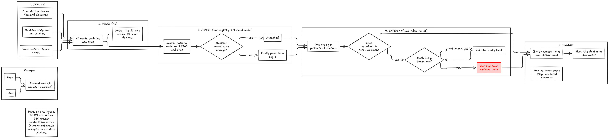
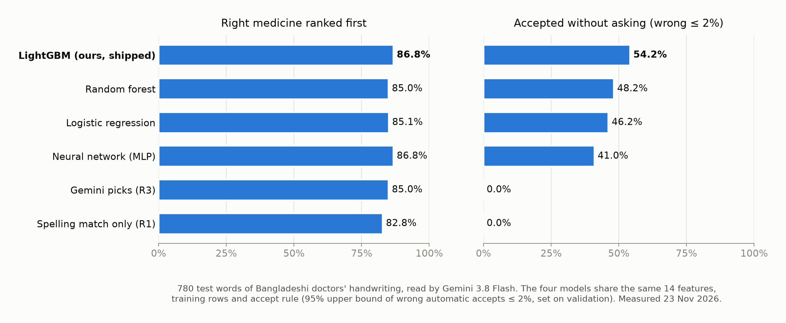

# Ek Oshudh, Dui Naam (এক ওষুধ, দুই নাম)

**Two names, one medicine.** An older person sees several doctors, each writes a favourite brand, and more medicine is
bought at the pharmacy. In Bangladesh the same ingredient is sold under very many names (in the registry we use:
Cefixime 146 brand names, Omeprazole 138, Paracetamol 117), so nobody at home can see that *Napa* and *Ace* are both
paracetamol.

This app is for the son or daughter sitting with a parent. Photograph the prescriptions and the strips in the
medicine bag (or say or type the names). The app turns every brand into the medicine inside it and shows, in Bangla,
when two names are one medicine **that is being taken now**, with a picture card and a voice reply to show the doctor
or pharmacist.

Team **Agentic Bekar** · CoU AI Hackathon 2026 finals.

## Run it locally

```bash
bash scripts/get_data.sh                                          # registry CSVs (public, MIT)
(cd web && npm ci && npm run build)                               # the web app, built into web/dist
cd backend && uv sync && uv run python -m app.core.graph          # build the knowledge graph (21,363 products)
uv run uvicorn app.main:app --host 0.0.0.0 --port 8000            # API + the web app at http://localhost:8000
```

Reading photos and voice needs a Gemini key in `.env` (`GEMINI_API_KEY=...`, see `.env.example`). Without it the app
says so, and typed names, the sample case, matching and every rule still work offline.

Try it: **নমুনা দেখুন** (a labelled sample computed live) → **মিলিয়ে দেখুন** → answer **এখন খাচ্ছেন?** for both →
the two names join at the one ingredient. Press **ফোনে খুলুন** for a QR code that opens the app on a phone on the
same Wi-Fi.

## How it works: the model reads, the registry and fixed rules decide

[](docs/architecture.png)

*Click the diagram to open it full size.* The same pipeline, step by step:

```
photos / voice / typed
  → 1 READ      Gemini 3.8 Flash reads each line into a strict schema (name, alternatives, strength, schedule,
                a box around the whole line); Gemini 3.1 Flash-Lite reads the same photo in parallel as a
                second opinion on the names; a voice note goes straight to Gemini 3.8 Flash, which returns the
                transcript and the names said (fallback: gemini-3.5-transcribe, then Flash-Lite lists the names)
  → 2 FIND      candidates from the national registry: character n-gram TF-IDF + edit distance + phonetic key
                + Bangla→Latin transliteration + local spellings (data/curated/aliases_local.csv)
  → 3 DECIDE    a trained LightGBM decision model ranks the candidates (14 explainable features) and accepts
                only when it is very sure; otherwise the family picks from the closest registered products
                (the photo line is shown) or searches the registry. It can never invent a medicine name.
  → 4 RECONCILE one case per patient: a prescription line and its own strip are one medicine; the same
                prescription photographed twice is not counted twice
  → 5 RULES     deterministic: same ingredient in two medicines both taken now (red); not yet known whether
                both are taken (the app asks); same drug family (needs checking); listed risky pairs
  → 6 EXPLAIN   Bangla templates only (config/copy_bn.json), always "show your doctor or pharmacist",
                never "stop"; voice reply (gemini-3.8-flash-tts); picture card with morning/noon/night icons
  → 7 PROVE     "কীভাবে জানলাম": every step of this check with timings, the matching benchmark, a live lookup
```

**Safety design** (reviewed for clinical safety; every point is pinned by a test in `backend/tests/test_clinical_safety.py`):

- No warning is written by a model. A reading the matcher is unsure of, and every spoken name, waits for the family's
  tap and cannot raise a warning before that.
- Never a false all-clear: while any line waits for confirmation the result says how many were **not checked** (screen,
  card and voice), and the all-clear says only what was checked ("একই ওষুধ দুবার নেই") and what is not covered.
- A bag holds old strips, so a duplicate turns red only when both medicines are marked **taken now**.
- Two lines on one prescription (Farin 5 mg + Farin 1 mg) may be one intended dose: that is a question for the doctor,
  never a red that could make a family drop one. Eye drops or a cream do not count as a second dose of a tablet.
- Dose limits are switched off until a pharmacist reviews them (`config/settings.json`); no cheaper-brand hint for
  narrow-therapeutic-index drugs such as warfarin or levothyroxine.
- The optional evidence agent (**সূত্র খুঁজুন**) only suggests: a step budget, a suggestion counts only if its own tools
  found it in this run, and the family sees a fixed sentence naming that evidence, never the model's own words.

## Onsite challenges (finals, 24 Nov)

Every case below is pinned by `backend/tests/test_challenges.py` (photo reader faked; matching, graph and rules real).

**1. Scan one medicine strip in several packets at once and get a single bag verdict** (direction: multi-strip bag
scan in one photo).
- One photo can hold several strips: each different product becomes its own card; the same product printed many times
  (English, Bangla, every blister, several packets) becomes one card.
- The same medicine across photos or packets is one medicine in the bag; only different names for one ingredient,
  both taken now, turn red. One verdict for the whole bag, never per photo.
- Several photos are read at the same time, and more can be taken while they are read; each photo shows what it gave
  ("ছবি ২: ২টি ওষুধ পাওয়া গেছে") and the bag is checked when all are done.
- Checked with real photos on 24 Nov: Napa + Ace strips in one photo gave 2 cards and one red; a composite of one strip
  in three packets gave 1 card; a composite of three products gave 3 cards; three photos read together took 21.5 s.

**2. Stay careful when a brand is unknown or the strip photo is unreadable, so nothing is wrongly called a duplicate.**
- A reading the decision model is not sure of, an unknown brand, or a spoken name waits for the family's tap and is
  left out of every rule until then; the verdict says how many medicines are not checked and is never an all-clear.
- An unreadable photo adds nothing and says so ("ছবিটা পড়া যায়নি, তাই কোনো ওষুধ ধরে নেওয়া হয়নি").
- A strip also prints its ingredient ("Esomeprazole USP" under Sergel MUPS). On 24 Nov a real read listed that line as
  a second medicine and the matcher offered another esomeprazole brand: one strip would have become a duplicate. Such
  a line, when it is the ingredient of another product in the same photo, is now dropped (an exact registered brand
  name, such as Calamine lotion, is kept).
- Checked with real photos: blurred strip -> nothing added; a 60x80 px strip -> one line, asked, not accepted; four
  unknown brand names typed next to known ones -> all asked, no duplicate.

## How well does the matching work?

Measured on real handwriting by Bangladeshi doctors: the public *Doctor's Handwritten Prescription BD* dataset
(Mendeley; 4,680 word images of 78 medicine names, split by its authors into 3,120 train / 780 validation / 780 test;
`scripts/get_handwriting.py` downloads it, see `data/LICENSES.md`). The decision model was trained on the train split,
thresholds were chosen on the validation split, and results are reported once on the test split the models never saw
(`eval/reports/e1_policy_gemini-3.8-flash.json`, `models/policy.json`).

| Matcher (Gemini 3.8 Flash reader) | Top-1 correct (dataset labels) | After label audit |
|---|---|---|
| R1 fuzzy string match | 82.8% | 84.1% |
| **R2 decision model (shipped)** | **86.8%** | **88.1%** |
| R3 AI picks from the top 5 | 85.0% | 86.3% |

- The right product is among the candidates for 93.8% of words.
- Shipped policy: accept automatically when the decision model's probability is ≥ 0.98, chosen so that the 95% upper
  bound of wrong automatic accepts on validation stays ≤ 2%. On test: 54.5% accepted automatically, 12 of 425 wrong
  as labelled; the other 45.5% are asked, and the right answer is among the three shown 83.9% of the time.
- Label audit (`eval/label_audit.csv`): we looked at every wrong automatic accept. 10 of the 12 were mistakes in the
  dataset's own labels (the image clearly shows the brand we chose); after the audit 2 of 425 (0.5%) are wrong, both
  changing the ingredient, which is why the photo line is always shown. Only disagreements were audited, so the
  audited figure is a best case; raw figures are always reported beside it.
- On 26 medicine names the decision model never saw in training: R2 80.4% vs R1 76.9% (Flash-Lite reader).
- **Why LightGBM** ([full comparison](eval/reports/model_comparison.md)): the same 14 features, training rows and 2% rule
  with other models. All rank about equally (85-87% top-1); at the 2% bound LightGBM accepts the most without asking
  (54.2% vs 41.0-48.2%), and Gemini alone or spelling alone accept none. Other models ran with default settings.

[](eval/reports/model_comparison.md)

These numbers measure name matching on word images, not the whole path from a phone photo to a warning.

**Strip and box photos, end to end** (`eval/reports/e2_strips.json`, `training/eval_strips.py`): 70 product photos of
40 common brands from online pharmacy listings, through the full pipeline (reader → registry → decision model). These
are clean studio photos, so this is an easier set than a phone photo at home, and it is reported as exactly that.

| 70 strip/box photos | Result |
|---|---|
| Right brand chosen | 98.6% (69/70; the miss was asked, not accepted) |
| Accepted without asking | 88.6% |
| Wrong automatic accepts | 0 |
| Strength right when the brand is right | 97.1% |
| Median time per photo | 4.6 s |

This run found a real bug: the reader writes the form in full ("tablets", "Capsules", "Suspension") and those words
were matched as letters of a name (Napa → Nitalet). After the fix, accepted-without-asking went from 35.7% to 88.6%
with still no wrong automatic accept (`tests/test_strip_reading.py` pins the cases).

## Tests

```bash
cd backend && uv run pytest -q          # 204 tests, no API key needed (also run in CI on every push)
cd web && npm run e2e                   # end-to-end at 1440×900 and 390×844 (Playwright), see below
python3 scripts/demo_check.py           # checks the running app end to end, with timings
```

The tests pin the safety rules (golden cases: Napa + Ace red only when both are taken now, Seclo + Maxpro needs
checking, combination products, syrups left out of dose sums, nothing ever says "stop"), the matching, the schedule
parser (১+০+১, দিনে দুইবার, রাতে), the API edge cases (not a photo, impossible doses, AI down, a slow reading not
freezing the server) and the wording file (no Arabic commas or invisible characters).

The end-to-end tests drive the real app in Chrome at laptop and phone size: the sample case (asks first, red only when
both are taken now, card, details), the not-sure path (registry search, remove and undo), an unconfirmed line never
shown as an all-clear, every verdict heading on one line, and no sideways scrolling at any step.

## Changing it on-site

| Request | Where | Restart? |
|---|---|---|
| Any Bangla or English wording | `config/copy_bn.json` | no (re-read on the next request) |
| Ask for confirmation on every line; accept threshold | `config/settings.json` → `matching` | yes |
| Switch a rule on or off (dose limits, "not on prescription") | `config/settings.json` → `rules` | yes |
| A local spelling of a brand | `data/curated/aliases_local.csv` | yes |
| A brand missing from the registry (with a source link) | `data/curated/products_local.csv`, then rebuild the graph | yes |
| A risky pair, a drug family, a dose limit | `data/curated/*.csv` (with the source sentence) | yes |
| The sample case | `config/settings.json` → `sample_case` | yes |

Restart: stop the server and run the last command above again. Then `uv run pytest -q` shows the change broke nothing.

## Also in the repo

- `backend/app/mcp_server.py`: the checker as MCP tools (`check_medicines`, `find_brand`) for any MCP client.
- `training/`: how the decision model was trained and evaluated (`train_decider.py`, `eval_policy.py`).
- `eval/`: reports and the label audit.

## Data and licences

See `data/LICENSES.md`. Product photos used for local testing are not redistributed. No patient data is stored;
cases live in memory for two hours.

This is a prototype, not medical advice. Every finding says to show the doctor or pharmacist.
