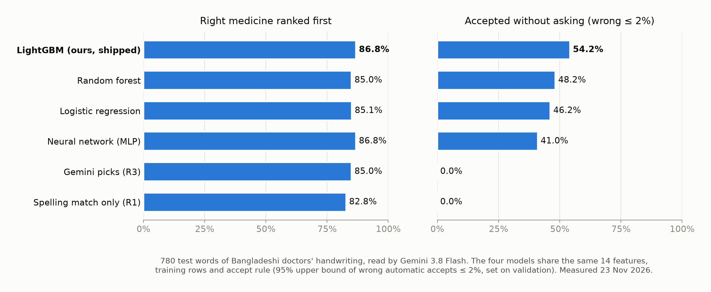

# Why LightGBM: checked against other models

The decision model (R2) takes the reader's text and the closest registry brands, and decides: accept this medicine, or
ask the family. We chose LightGBM on 21 Nov 2026 for four reasons: it gives a probability we can hold to a stated error
bound, every one of its 14 features can be explained, it fits small tables of numbers, and it runs offline in
milliseconds. On 23 Nov 2026 we checked that choice against the obvious alternatives.



## Setup (the same for every model)

- **Features:** the same 14 numbers per candidate (`backend/app/core/decide.py`).
- **Training rows:** the same 104,269 rows: Gemini 3.1 Flash-Lite readings of the 3,120 training images of the
  *Doctor's Handwritten Prescription BD* dataset, plus 3,000 registry names with realistic reading noise
  (`training/train_decider.py`).
- **Accept rule:** each model picks its own threshold on the 780 validation words with the same rule: the 95% upper
  bound of wrong automatic accepts must stay at or below 2% (`training/eval_policy.py`).
- **Test:** scored once on the 780 test words, read by Gemini 3.8 Flash (the reader the app ships). No AI calls: the
  saved readings are reused.

## Results on the 780 test words

| Model | Right medicine ranked first | Accepted without asking | Wrong among those (raw / after label audit) | Right answer in the 3 shown when asked |
|---|---|---|---|---|
| **LightGBM (shipped)** | **86.8%** | **54.2%** (423 words) | 12 / 2 | 84.0% |
| Random forest | 85.0% | 48.2% (376) | 7 / 1 | 83.9% |
| Logistic regression | 85.1% | 46.2% (360) | 10 / 2 | 83.3% |
| Neural network (MLP 32-16) | 86.8% | 41.0% (320) | 8 / 1 | 85.9% |
| Gemini picks from the top 5 (R3) | 85.0% | 0% | none accepted | |
| Spelling match only (R1) | 82.8% | 0% | none accepted | |

R1 and R3 come from `eval/reports/e1_policy_gemini-3.8-flash.json` (same 780 test words, same rule).

## What it shows

- **All four models rank about equally well (85-87%).** The 14 features carry the ranking.
- **LightGBM lets the most words through safely.** At the same 2% bound it accepts 54.2% of words without asking,
  against 41.0-48.2% for the others: 47 to 103 fewer questions to the family per 780 words.
- **A model that is only "about as accurate" is not enough here.** What matters is how confidently it can say "I am
  sure"; Gemini alone (R3) ranks well but its confidence could not support a single automatic accept within 2%.
- LightGBM also trains in about a second, the model file is 530 KB, and it answers in milliseconds on a laptop.

## Limits, said plainly

- One run on one dataset (78 medicine names). The other models used default settings; tuning them could narrow the gap.
- The shipped model accepts 54.2% here and 54.5% in `models/policy.json` (423 vs 425 words). The only change we know
  of between the two runs is one product added to the registry on 23 Nov (`data/curated/products_local.csv`), which
  can shift candidate lists slightly; we report the newer run.

## Reproduce

```bash
cd backend
uv run --group training python ../training/compare_models.py      # writes eval/reports/model_comparison.json
uv run --with matplotlib python ../training/plot_model_comparison.py   # writes docs/model_comparison.png
```
